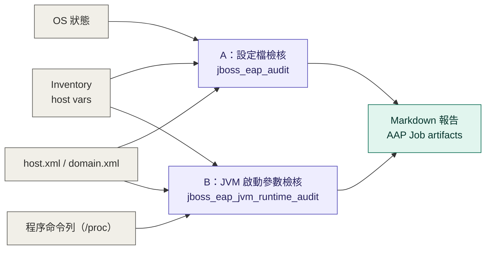

# JBoss EAP Domain Mode 唯讀檢核

本專案提供兩支可由 Ansible Automation Platform（AAP）執行的獨立唯讀 Playbook：第一項 A 盤點 JBoss EAP 與 JVM 設定檔，第一項 B 對應執行中的 managed server JVM 並核對啟動參數。

## 目前使用環境

- Ansible Automation Platform（AAP）2.6
- Red Hat JBoss Enterprise Application Platform（JBoss EAP）8.1，Domain Mode

## 設計原則

- 不修改受管 JBoss EAP 主機。
- OS 狀態優先使用 `ansible.builtin` module。
- `host.xml` 與 `domain.xml` 先以 `slurp` 讀回，在 AAP Execution Environment 解析；A 使用 XML module，B 使用 Python XML filter，受管主機不必額外安裝 `lxml`。
- B 在受管主機唯讀取樣 `/proc/<pid>/cmdline`，僅保留程序對應證據與記憶體啟動參數，不輸出完整命令列。
- Keystore 密碼不得存入 Git；由 AAP encrypted survey、custom credential 或 Ansible Vault 注入。
- 每台主機產生獨立 Markdown 報告，並透過 `set_stats` 公布摘要。

## 為什麼第一版沒有直接使用 redhat.eap

`redhat.eap` 主要負責 JBoss EAP 的安裝、systemd 建置與設定管理。這個專案的目標是盤點既有 Domain Mode 環境，並不執行安裝或修改，因此第一版不套用 provisioning role。

當專案未來增加「建立標準化 EAP、部署 JDBC driver、建立 systemd unit」等功能時，再將 `redhat.eap` 納入對應的變更型 Playbook。

## 專案結構

```text
jboss-eap-playbooks/
├── .gitignore                         # 排除本機報告與機敏檔案
├── README.md                          # 使用說明與待辦清單
├── ansible.cfg                        # Ansible 執行預設值
├── collections/
│   └── requirements.yml               # 所需 Ansible Collections
├── docs/
│   └── check-mapping.md                # 原始檢核與實作對照
├── inventory/
│   └── hosts.yml                       # Inventory 範例
├── playbooks/
│   ├── jboss_eap_audit.yml             # A：設定檔與 OS 檢核入口
│   └── jboss_eap_jvm_runtime_audit.yml # B：JVM 啟動參數檢核入口
├── requirements.txt                   # Execution Environment 的 Python 套件
├── roles/
│   ├── jboss_eap_audit/                # A：靜態設定與 OS 檢核
│   │   ├── defaults/main.yml          # A 的預設變數
│   │   ├── filter_plugins/jboss_eap_jvm.py  # 整理 JVM 設定層級
│   │   ├── tasks/
│   │   │   ├── domain_xml.yml         # 讀取 domain.xml 設定
│   │   │   ├── main.yml               # 排列 A 的檢核步驟
│   │   │   ├── os.yml                 # 帳號、套件與服務狀態
│   │   │   ├── report.yml             # 產生報告與 AAP artifacts
│   │   │   └── static_config.yml      # 讀取設定檔並解析 XML
│   │   └── templates/report.md.j2     # A 的 Markdown 報告
│   └── jboss_eap_jvm_runtime_audit/    # B：執行中 JVM 檢核
│       ├── defaults/main.yml          # B 的預設變數
│       ├── filter_plugins/jboss_eap_jvm.py  # 整理設定檔對照值
│       ├── library/jboss_eap_runtime.py     # 對應程序並解析啟動參數
│       ├── tasks/main.yml             # 排列 B 的檢核與報告步驟
│       └── templates/report.md.j2     # B 的 Markdown 報告
└── tests/
    ├── test_jboss_eap_jvm.py           # JVM 設定檔解析測試
    └── test_jboss_eap_runtime.py       # 程序對應與參數解析測試
```

## AAP 設定

1. 將整個目錄提交到 Git repository。
2. 在 AAP 建立 Project 並同步該 repository。
3. 建立包含 `community.general` 與 `lxml` 的 Execution Environment。
4. 建立 Machine Credential，使用可讀取 JBoss 設定檔並可執行 privilege escalation 的帳號。
5. 建立 Inventory，主機放入 `jboss_eap` group。
6. 建立 Job Template，Playbook 選擇 `playbooks/jboss_eap_audit.yml`。
7. 若要檢查 keystore，使用 encrypted survey 或 custom credential 傳入 `jboss_keystore_password`。
8. 另建 JVM 執行狀態 Job Template，Playbook 選擇 `playbooks/jboss_eap_jvm_runtime_audit.yml`。使用可讀取 `/proc/<pid>/cmdline` 的帳號；若需 `become`，不需授權啟停服務。Inventory 中 primary、secondary 即使共用 `ansible_host`，也要分別指定實際的 `jboss_host_config` 與 `jboss_domain_config`。主機專屬路徑請放在 Inventory host variables，避免 Template Extra Variables 的共用值覆蓋兩個別名；兩者共用的 `jboss_eap_home` 可放在 Template Extra Variables。

## 本機測試

```bash
ansible-galaxy collection install -r collections/requirements.yml
python3 -m pip install -r requirements.txt
ansible-playbook -i inventory/hosts.yml playbooks/jboss_eap_audit.yml
ansible-playbook -i inventory/hosts.yml playbooks/jboss_eap_jvm_runtime_audit.yml
python3 -m unittest discover -s tests
```

## 可覆寫變數

以下是第一項 A 的變數範例；其中 B 只使用 `jboss_eap_home`，不使用 `jboss_user`、keystore、版本檔或 init 設定檔變數。

```yaml
jboss_eap_home: /opt/jboss-eap
jboss_user: jboss
jboss_keystore_path: /opt/jboss-eap/domain/configuration/example.keystore
jboss_keystore_password: "由 AAP 加密欄位注入"
jboss_service_candidates:
  - jboss-eap.service
  - eap-domain-primary.service
  - eap-domain-secondary.service
```

若主機使用 `host-primary.xml` 作為 Domain Controller 設定，該檔案可能沒有 managed server。此時 `configured_servers: []` 只代表這份 host 設定檔沒有宣告 server。要盤點其他 host controller，請將其實際使用的設定檔指定給 `jboss_host_config`；同一台 OS 主機有多個 host controller 時，可在 Inventory 建立不同主機別名，分別指定 `jboss_host_config` 與 `jboss_domain_config`。

兩支 Playbook 都讀取 `jboss_host_config` 與 `jboss_domain_config`。B 可另外以 `jboss_runtime_output_dir` 覆寫報告目錄；A 的對應變數是 `jboss_audit_output_dir`，兩者互不影響。AAP 預設寫入該次 Job 的 artifacts 目錄，通常不需自行指定輸出路徑。

例如同機雙 controller 可設定：

```yaml
jboss_eap:
  hosts:
    eap-primary:
      ansible_host: 192.0.2.10
      jboss_host_config: /srv/primary/configuration/host-primary.xml
      jboss_domain_config: /srv/primary/configuration/domain.xml
    eap-secondary:
      ansible_host: 192.0.2.10
      jboss_host_config: /srv/secondary/configuration/host-secondary.xml
      jboss_domain_config: /srv/primary/configuration/domain.xml
```

`jboss_domain_config` 應指向該別名實際要對照的 `domain.xml`，不必與 `jboss_host_config` 位於同一個 base directory。本次 AAP 驗證中，secondary 使用 host1 的 `host-secondary.xml`，但對照的是 host0 的 `domain.xml`。

執行中的 host controller 必須能以 `--host-config`（未指定時為 `host.xml`）和 `jboss.domain.base.dir` 對應到該別名的設定檔；managed server 必須有 `-D[Server:<name>]` 標記，且使用同一個 base directory。對應不唯一、程序未執行或 `/proc` 有無權讀取的程序時，報告標示「未知／無法確認」。只保留 PID、對應依據與 `-Xms`、`-Xmx`、`-XX:MaxDirectMemorySize` 的數值證據，不保存完整命令列。沒有明確 JVM 選項時不推測預設或有效值。

## 報告

- AAP：Job 的 **Output** 會顯示每台主機的可讀摘要。完整 Markdown 內容透過 `set_stats` 存在 Job API 的 `artifacts.jboss_eap_audit_<主機名>.report_markdown`；`report_path` 是執行端的檔案路徑，不是 AAP UI 的下載連結。
- 本機：報告預設寫入 `reports/<inventory_hostname>-jboss-eap-audit.md`。
- 靜態報告寫檔及發佈至 AAP artifacts 前，會遮蔽常見密碼、token 與 URL 帳密參數；仍請限制報告存取權限。
- JVM 啟動參數：本機另寫入 `reports/<inventory_hostname>-jboss-eap-jvm-runtime-audit.md`；AAP artifact key 為 `jboss_eap_jvm_runtime_audit_<主機名>`，內含 `report_markdown`、`report_path` 與逐 server `summary`。`report_path` 位於 AAP 執行端的該次 Job 目錄，不是受管主機上的持久檔案。

在 AAP 執行完後，從 Job 頁面取得 Job ID，於相同網站開啟 `/api/v2/jobs/<Job ID>/`，即可在 `artifacts` 找到完整報告。API 回傳的是 JSON；若需要排版後的 Markdown 檔，可將 `report_markdown` 欄位另存為 `.md` 檔。

兩份原始指令如何合併與替換，請參考 [`docs/check-mapping.md`](docs/check-mapping.md)。

## PDF 指引差距與待辦 Checklist



對照 [`JBoss EAP 常見問題排查與資料收集指引.pdf`](JBoss%20EAP%20常見問題排查與資料收集指引.pdf)：

- [x] **第一項 A：JVM 設定檔。** 2026-10-13 於 AAP 2.6／EAP 8.1 驗證：primary 無 managed server；secondary 找到 `server-one`、`server-two`，列出 group、JVM 設定層級與 Heap 來源。
- [x] **第一項 B：JVM 啟動參數。** 同日驗證：secondary 兩台 server 均唯一對應至各自 JVM，`-Xms1000m`、`-Xmx1000m` 與 XML 一致，Markdown 與 artifacts 正常產出。未設定 `MaxDirectMemorySize`；其有效上限仍未知。
- [ ] **Direct Buffer runtime 指標。** 另建唯讀 Playbook，逐台收集 `count`、`memory-used`、`total-capacity` 與取樣時間；上限未知時不計算使用率。
- [ ] **Thread churn。** 收集 thread count、累計啟動數、uptime；按需取 thread dump 檢查 `default task-*`。
- [ ] **趨勢、告警與 OOM log。** 保存歷史取樣、設定可調門檻，檢查 Direct Buffer OOM 記錄。
- [ ] **Undertow／IO worker。** 盤點 buffer pool、`task-core-threads`、`task-max-threads` 等設定。
- [ ] **升級準備。** 盤點 EAP update level、JDK、OS 與相容性測試，依目標版本判讀。
- [ ] **事件處置。** 另行設計 heap dump、suspend、逐台 restart 等明確觸發的流程，不併入唯讀檢核。

PDF 的版本與支援期限資訊應在規劃升級時重新核對官方文件。

## 參考文件

- [JBoss EAP 8 Managed Domains](https://docs.redhat.com/en/documentation/red_hat_jboss_enterprise_application_platform/8.0/html/configuration_guide/about-eap-managed-domains_default)
- [JBoss EAP 8 Management](https://docs.redhat.com/en/documentation/red_hat_jboss_enterprise_application_platform/8.0/html/configuration_guide/eap-mgmt-overview_default)
- [Ansible built-in modules](https://docs.ansible.com/projects/ansible/latest/collections/ansible/builtin/index.html)
- [community.general.xml](https://docs.ansible.com/projects/ansible/latest/collections/community/general/xml_module.html)
- [Ansible Middleware WildFly/EAP collection](https://github.com/ansible-middleware/wildfly)
